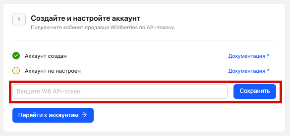
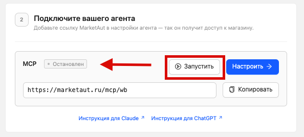
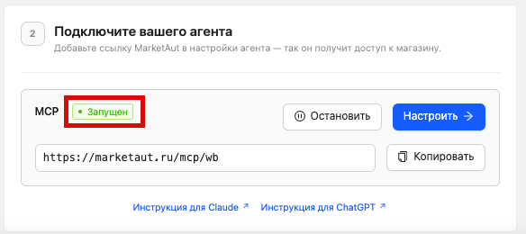
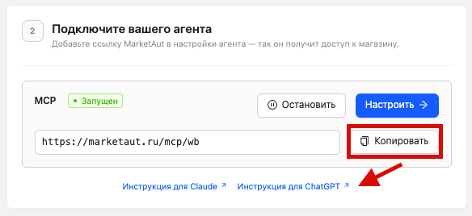
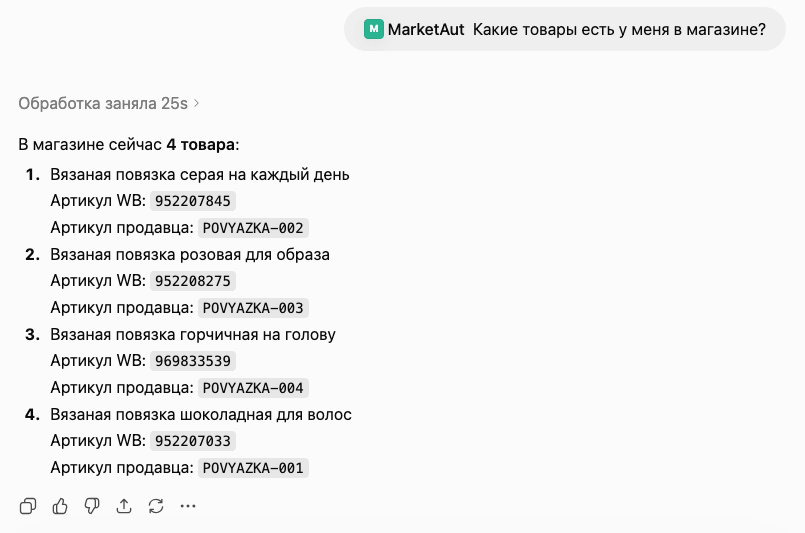

# Руководство: быстрый старт

Это руководство поможет подключить магазин Wildberries к ChatGPT и начать использовать возможности ИИ для работы с вашим магазином.

Все примеры, приведённые ниже, предполагают, что вы уже зарегистрировались и вошли на платформу.

Если вы ещё не зарегистрировались или не выполнили вход, следуйте инструкциям из раздела [Регистрация](../3-start/01-register.md).

После регистрации в MarketAut первый [аккаунт](../4-platform/01-accounts.md) и первая [диаграмма](../4-platform/03-diagrams.md) создаются автоматически.

**Вам не нужно создавать их вручную — достаточно получить API-токен Wildberries, добавить его в аккаунт, запустить агента и подключить ChatGPT.**

## Что потребуется  

Перед началом убедитесь, что у вас есть:

- учётная запись MarketAut; 
- учётная запись ChatGPT; 
- доступ владельца к личному кабинету продавца Wildberries — только владелец может создать API-токен.

## Получение API-токена Wildberries

API-токен позволяет MarketAut получать данные вашего магазина и выполнять действия от его имени.

Проще всего создать токен по прямой ссылке:

1. Откройте [MarketAut в каталоге сервисов Wildberries](https://seller.wildberries.ru/auth-services?id=marketaut.ru).
2. Проверьте отмеченные категории доступа — они выбираются автоматически. Для категорий должен быть установлен уровень доступа **Чтение и запись**: с уровнем **Только чтение** ИИ не сможет отвечать покупателям и изменять карточки.
3. Нажмите **Создать токен**, затем **Скопировать** — токен понадобится на следующем шаге.

> ⚠️ **ВАЖНО:** сохраните токен.
>  После закрытия окна посмотреть токен повторно нельзя. Если вы не успели его скопировать, создайте новый.

Если ссылка не открывается, токен можно создать вручную. Этот способ, а также описание всех категорий доступа — в разделе [Получение API-токена](../3-start/03-api-token.md).

## Настройка аккаунта MarketAut

После получения API-токена необходимо добавить его в MarketAut.

Откройте главную страницу MarketAut. 

В блоке **Создайте и настройте аккаунт** вставьте полученный API-токен в соответствующее поле и нажмите **Сохранить**. 

После сохранения аккаунт будет готов к работе.

> Подробнее об аккаунтах см. в разделе [Аккаунты](../4-platform/01-accounts.md).

## Запуск диаграммы для ИИ-агента

После настройки аккаунта необходимо запустить агента.

В блоке **Подключите вашего агента** нажмите **Запустить**, если агент ещё не запущен. 

После запуска статус агента изменится на **Запущен**.

> Подробнее о диаграммах см. в разделах [Диаграммы](../4-platform/03-diagrams.md) и [Настройка диаграммы](../4-platform/04-diagrams-edit.md).

## Подключение ChatGPT

После настройки аккаунта и запуска агента подключите MarketAut к ChatGPT. 

Для подключения понадобится MCP-адрес. 

На домашней странице MarketAut в блоке **Подключите вашего агента** нажмите **Копировать**.

Далее выполните следующие действия в ChatGPT:

1. Перейдите в раздел **Плагины**;
2. Справа нажмите **Добавить** и выберите **Добавить пользовательский сервер MCP**;
3. Введите название, например MarketAut WB;
4. В поле **Подключение** вставьте скопированный адрес, **Аутентификация** — OAuth;
5. Установите флажок **Я понимаю и хочу продолжить** и нажмите **Создать в виде плагина**;
6. Нажмите **Подключить MarketAut WB** и в окне авторизации нажмите **Разрешить доступ**.

>Подробнее о подключении см. в разделе [Подключение ChatGPT](../5-ai/02-chat-gpt.md).

## Проверка подключения 

1. Откройте новый чат ChatGPT. 
2. Нажмите **+** рядом с полем ввода сообщения.
3. Выберите **MarketAut WB**. 
4. Задайте вопрос о вашем магазине, например:

> Какие товары есть у меня в магазине?

Если ChatGPT показал ваши товары, подключение завершено.
