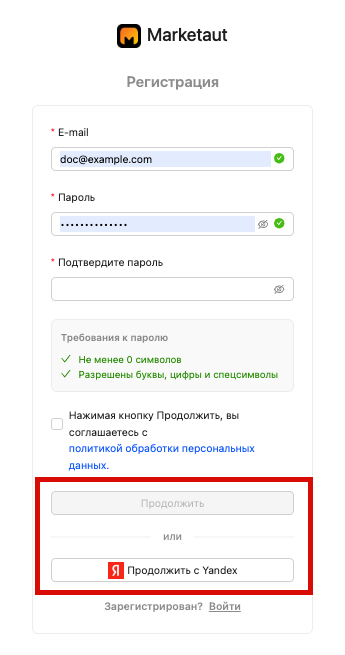
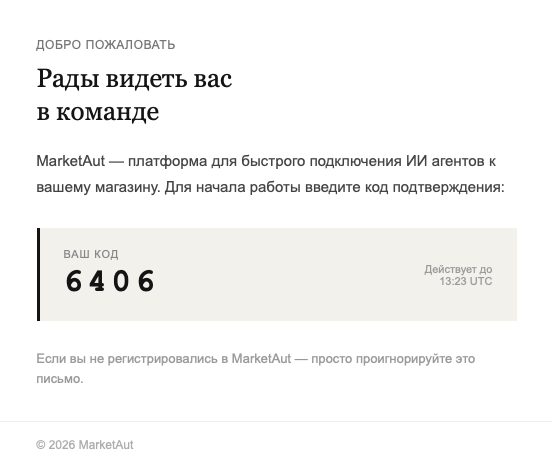
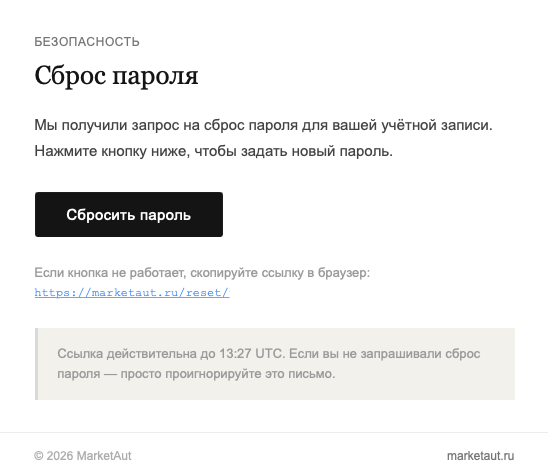

# Регистрация

Зарегистрироваться в MarketAut можно двумя способами:

- по адресу электронной почты;
- через учётную запись Яндекс.

## По электронной почте

1. Перейдите на [страницу регистрации](https://marketaut.ru/auth/signup);
2. Укажите адрес электронной почты, придумайте пароль и повторите его;
3. Отметьте согласие с политикой обработки персональных данных и нажмите **Продолжить**;

    

4. Введите код подтверждения из письма.

    

После подтверждения будет создана ваша учётная запись MarketAut.

Если письмо не пришло в течение нескольких минут:

- проверьте папку «Спам»;
- убедитесь, что адрес электронной почты указан без ошибок;
- при необходимости запросите отправку письма повторно.
## Через Яндекс

1. Перейдите на [страницу регистрации](https://marketaut.ru/auth/signup);
2. Нажмите **Продолжить с Яндекс**;
3. Войдите в учётную запись Яндекс или выберите аккаунт, в который уже выполнен вход.

После авторизации будет создана ваша учётная запись MarketAut.

# Вход

После регистрации система запоминает вход на устройстве и автоматически авторизует вас при следующих посещениях сайта.

При входе с нового устройства или после выхода из учётной записи войдите тем же способом, что и при регистрации: по адресу электронной почты или через Яндекс.

# Восстановление пароля

Если вы зарегистрировались через Яндекс, пароль восстанавливается в сервисе Яндекс.

Если вы регистрировались по электронной почте:

1. На странице входа нажмите **Восстановить пароль**;
2. Укажите адрес электронной почты, который использовали при регистрации;
3. Откройте письмо и нажмите **Сбросить пароль**, затем придумайте новый пароль.

    

Если кнопка в письме не работает, скопируйте ссылку из письма и откройте её в браузере. Ссылка действует ограниченное время — если срок истёк, запросите письмо повторно.

Если письмо не пришло в течение нескольких минут:

- проверьте папку «Спам»;
- убедитесь, что адрес электронной почты указан без ошибок;
- при необходимости запросите отправку письма повторно.
