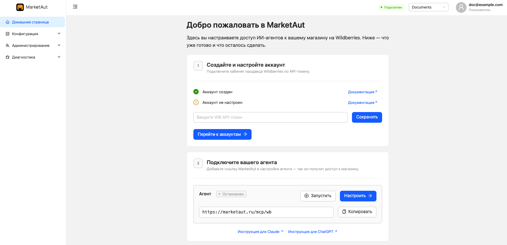
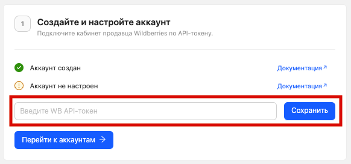
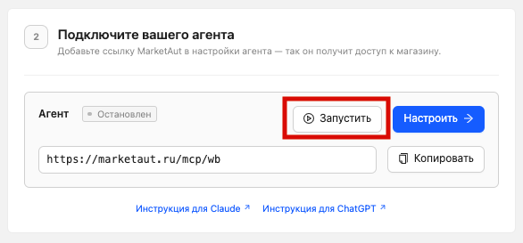
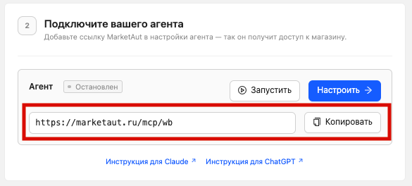

# Домашняя страница

После регистрации и входа в MarketAut пользователь автоматически попадает на домашнюю страницу. 

При регистрации платформа уже создаёт:

- один аккаунт Wildberries;
- одну диаграмму для подключения ИИ-агента.

Создавать их вручную для первоначальной настройки не нужно. Остаётся добавить API-токен Wildberries, запустить диаграмму и скопировать МСР-адрес для подключения ИИ-агента.

## Добавление  API-токена Wildberries

Если у вас ещё нет API-токена, подробную инструкцию по его созданию и выбору категорий доступа см. в разделе [Получение API-токена](../3-start/03-api-token.md).

Вставьте API-токен Wildberries в поле **Введите WB API-токен** и нажмите **Сохранить**.

После сохранения токена аккаунт будет настроен, а соответствующие пункты отметятся зелёными галочками.
## Запуск диаграммы

После сохранения API-токена в блоке **Подключите вашего агента** нажмите **Запустить**.

После запуска статус агента изменится на **Запущен**.

## MCP-адрес

В этом же блоке отображается MCP-адрес для подключения агента к MarketAut.

Нажмите **Копировать**, чтобы скопировать адрес в буфер обмена.

Этот адрес потребуется при подключении ChatGPT, Claude, Gemini, Grok или QwenWork.
## Что дальше? 

После копирования адреса перейдите в раздел [Работа с ИИ](../5-ai/00-intro.md) и выберите нужный ИИ-сервис. Дополнительные аккаунты и диаграммы при необходимости можно создать позже в соответствующих разделах платформы.
