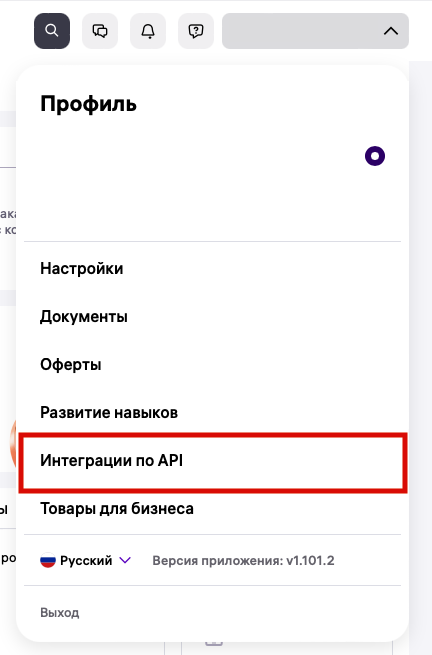
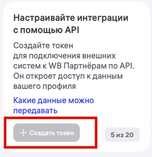
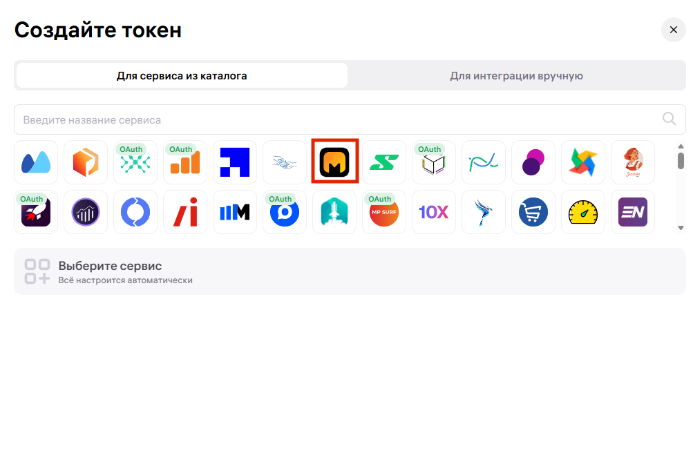
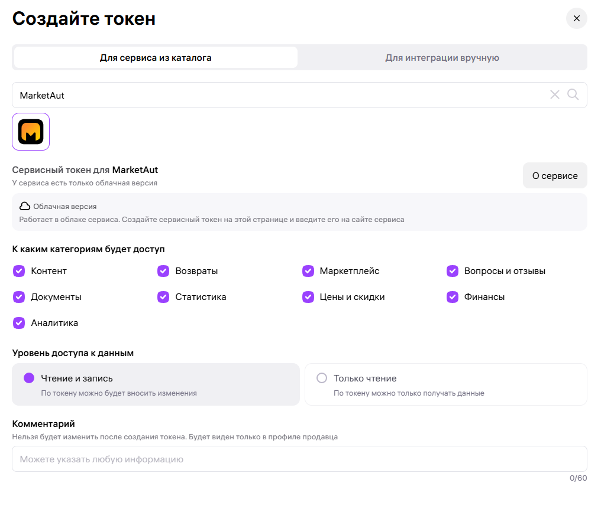
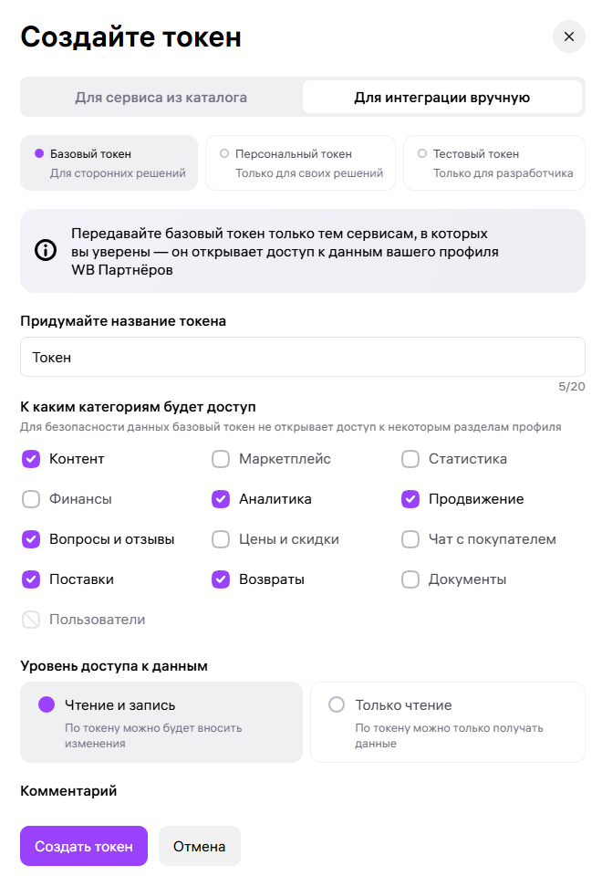

# Получение API-токена Wildberries

API-токен позволяет MarketAut получать данные из личного кабинета продавца и выполнять действия от его имени в рамках выбранных разрешений.

⚠️ ВАЖНО: создать API-токен может только владелец личного кабинета Wildberries.

> MarketAut входит в список проверенных сервисов Wildberries.
> 
> [Проверить MarketAut на сайте Wildberries →](https://seller.wildberries.ru/auth-services?id=marketaut.ru)

Создать токен можно тремя способами:

- [по прямой ссылке](#direct-link) — самый быстрый;
- [через поиск в каталоге сервисов](#catalog-search);
- [вручную](#manual).

## По прямой ссылке {#direct-link}

1. Откройте [MarketAut в каталоге сервисов Wildberries](https://seller.wildberries.ru/auth-services?id=marketaut.ru);
2. Проверьте категории доступа — они отмечаются автоматически;
3. Нажмите **Создать токен**, затем **Скопировать**.

Подробнее — в разделе [Создание и копирование токена](#copy-token).

## Через поиск в каталоге {#catalog-search}

1. Откройте Портал продавца Wildberries и войдите в личный кабинет;
2. В левом меню выберите **Настройки → Интеграции по API**;

    

3. Нажмите **Создать токен**;

    

4. Откройте вкладку **Для сервиса из каталога**;
5. В поле **Введите название сервиса** начните вводить `MarketAut` и выберите сервис с логотипом MarketAut.

    

Категории доступа отметятся автоматически. Ненужные можно отключить, но тогда связанные с ними инструменты MarketAut будут недоступны.

## Вручную {#manual}

1. Выполните шаги 1–3 из раздела [Через поиск в каталоге](#catalog-search);
2. Откройте вкладку **Для интеграции вручную** и выберите **Базовый токен**;

    

3. В поле **Придумайте название токена** укажите любое название, например `MarketAut`;
4. Отметьте категории доступа.

Для основных функций MarketAut отметьте как минимум эти категории:

| Категория | Для чего используется |
|---|---|
| Контент | Работа с карточками товаров, характеристиками и фотографиями |
| Вопросы и отзывы | Просмотр вопросов и отзывов покупателей, а также отправка ответов |
| Чат с покупателем | Получение и отправка сообщений покупателям |

Остальные категории («Возвраты», «Маркетплейс», «Документы», «Статистика», «Цены и скидки», «Финансы», «Аналитика») выбирайте в зависимости от инструментов, которые планируете использовать. Какая категория нужна каждому инструменту — в разделе [Инструменты](../4-platform/05-tools.md).

## Уровень доступа

Для выбранных категорий установите уровень доступа **Чтение и запись**. Он позволяет MarketAut:

- отвечать на отзывы и вопросы;
- отправлять сообщения покупателям;
- изменять данные карточек товаров;
- загружать фотографии;
- выполнять другие доступные действия через API Wildberries.

С уровнем **Только чтение** MarketAut сможет получать информацию, но не сможет вносить изменения.

## Создание и копирование токена {#copy-token}

1. Проверьте выбранные параметры и нажмите **Создать токен**;
2. Нажмите **Скопировать**.

⚠️ ВАЖНО: после закрытия окна посмотреть токен повторно нельзя. Если вы не успели его скопировать, создайте новый.

Не публикуйте API-токен в открытом доступе и передавайте его только сервисам, которым доверяете: токен даёт доступ к данным личного кабинета.

## Добавление токена в MarketAut

1. Откройте [домашнюю страницу MarketAut](https://marketaut.ru/app/home);
2. Вставьте токен в поле **Введите WB API-токен** и нажмите **Сохранить**.

Система проверит токен и подключит аккаунт Wildberries. После этого можно пользоваться инструментами MarketAut.

