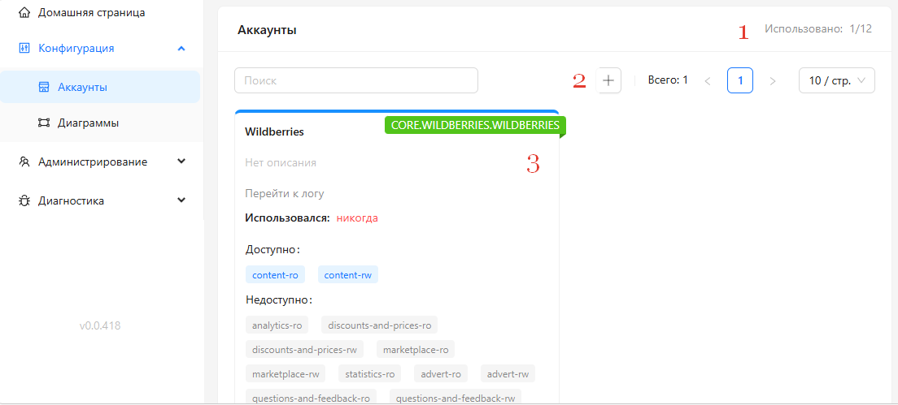
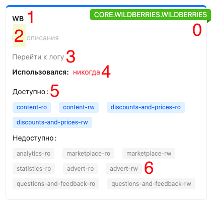
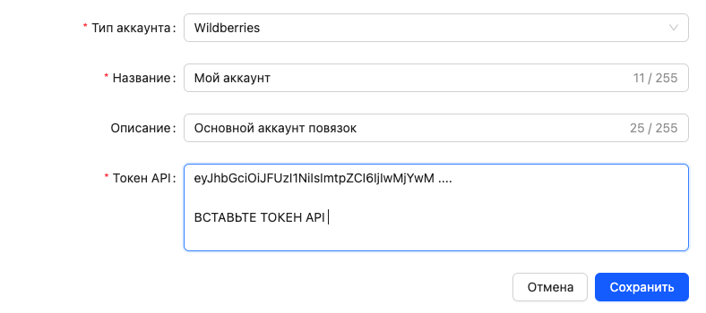
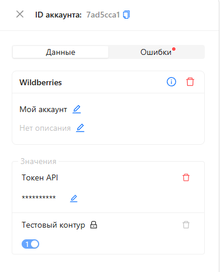
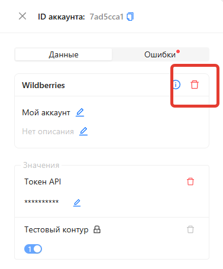
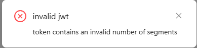

# Аккаунты

**Аккаунт** —  это сохранённые учётные данные для подключения к внешним сервисам. Например, API-токен Wildberries или логин и пароль для другого сервиса.

Аккаунт настраивается один раз, после чего может использоваться в любых узлах, которым требуется доступ к соответствующему сервису. Это позволяет не вводить одни и те же данные повторно в каждом узле.

Все аккаунты хранятся в команде и доступны её участникам.

## Управление

Для управления аккаунтами откройте раздел [Конфигурация → Аккаунты](https://marketaut.ru/app/config/accounts).

(1) Количество созданных аккаунтов и лимит аккаунтов;
(2) Кнопка создания нового аккаунта;
(3) Список созданных аккаунтов.

## Информация об аккаунте

(0) Тип аккаунта;
(1) Наименование аккаунта, указанное при его создании;
(2) Описание аккаунта;
(3) Кнопка перехода к  журналу событий  аккаунта;
(4) Сведения о последнем использовании аккаунта;
(5) Доступные разделы;
(6) Недоступные разделы.

<h5 id="ref_account_create"></h5>
## Создание аккаунта

1. Перейдите в раздел  [Конфигурация → Аккаунты](https://marketaut.ru/app/config/accounts);
2. Нажмите кнопку **+ Создать аккаунт;**
3. Выберите нужный тип аккаунт;
Тип аккаунта определяет внешний сервис, для которого будут храниться учётные данные. Подробнее о типах аккаунтов см. в разделе [Типы аккаунтов](02-account-types.md).
4. Заполните поля:

    - **Название** — обязательное поле, любое удобное название;
    - **Описание** — необязательное поле;
    - **Остальные поля** — зависят от выбранного типа аккаунта.

5. Нажмите кнопку **Сохранить**.

<h5 id="ref_account_edit"></h5>
Для аккаунта Wildberries потребуется API-токен. Подробнее о его создании и настройке см. в разделе [Получение API-токена](../3-start/03-api-token.md).

## Редактирование аккаунта

1. Перейдите в раздел [Конфигурация → Аккаунты](https://marketaut.ru/app/config/accounts);
2. Нажмите на нужный аккаунт — откроется окно аккаунта;
3. Нажмите на значок карандаша рядом с полем, которое хотите изменить;
4. Введите новое значение и нажмите **Enter**.

## Удаление аккаунта

⚠️ ВАЖНО: после удаления аккаунта связанные с ним диаграммы перестанут работать, а подключение магазина к ИИ станет недоступно. Перед удалением убедитесь, что аккаунт не используется в активных диаграммах.

1. Перейдите в раздел  [Конфигурация → Аккаунты](https://marketaut.ru/app/config/accounts);
2. Нажмите на аккаунт, который нужно удалить;
3. Нажмите значок корзины;
4. Подтвердите удаление.

## FAQ

### ⚠️ Не создаётся аккаунт: ошибка invalid jwt

Ошибка означает, что Wildberries не принял API-токен. Проверьте, что:

- токен скопирован полностью, без пробелов в начале и в конце;
- вставлен именно API-токен, а не его название;
- токен не удалён в личном кабинете Wildberries.

Если не помогло, создайте новый токен по инструкции [Получение API-токена](../3-start/03-api-token.md).

