# Настройка диаграммы

1. Перейдите в раздел [**Конфигурация → Диаграммы**](https://marketaut.ru/app/config/diagrams);
2. Откройте нужную диаграмму.

## Элементы холста

(1) Название диаграммы и кнопка редактирования;
(2) Текущее состояние диаграммы;
(3) Количество используемых узлов и доступный лимит;
(4) Версия диаграммы;
(5) Идентификатор (ID) диаграммы;
(6) Панель инструментов;
(7) Холст с размещёнными на нём узлами, группами и связями;
(8) Элементы управления масштабом;
(9) Журнал событий.

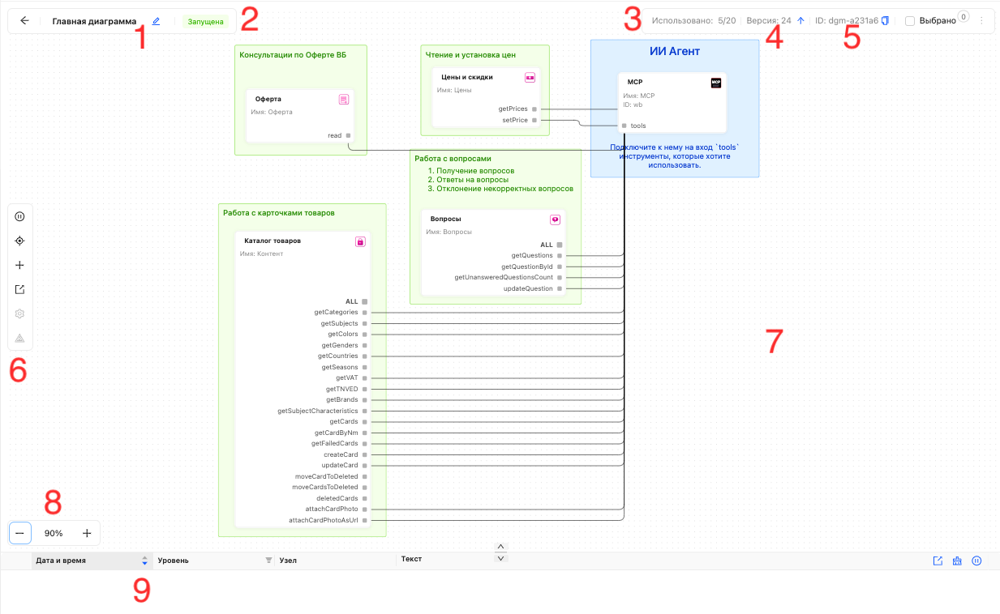

## Добавление узла

1. Нажмите **+** на левой панели инструментов;

    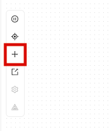

2. В открывшейся панели выберите нужную группу узлов;
3. Найдите нужный узел и нажмите **Добавить**.

    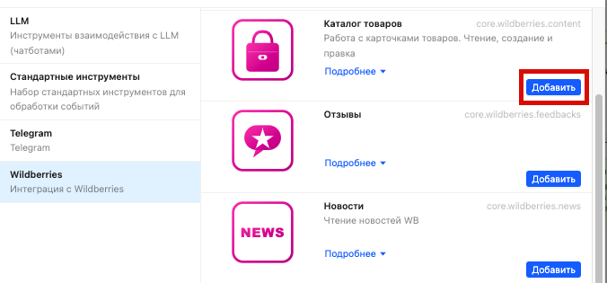

## Редактирование узла

1. Нажмите на нужный узел на диаграмме — справа откроется панель свойств узла;
2. Перейдите на вкладку **Свойства**, внесите изменения и нажмите **Сохранить**.

(1) Описание узла;
(2) Уникальный идентификатор (ID) узла;
(3) Имя узла;
(4) Область настройки свойств узла;
(5) Кнопки удаления узла и закрытия панели свойств.

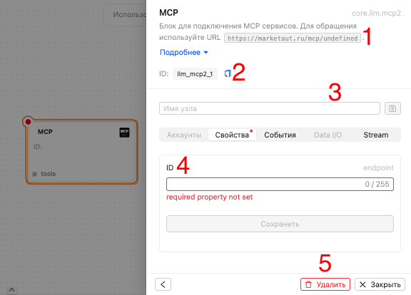
### Индикатор незаполненных параметров

Красная точка рядом с узлом означает, что его настройка не завершена и обязательные параметры не заполнены:

- для узла MCP требуется указать ID во вкладке **Свойства**;
- для узлов Wildberries требуется выбрать аккаунт во вкладке **Аккаунты**.

После заполнения и сохранения обязательных параметров красная точка исчезнет.

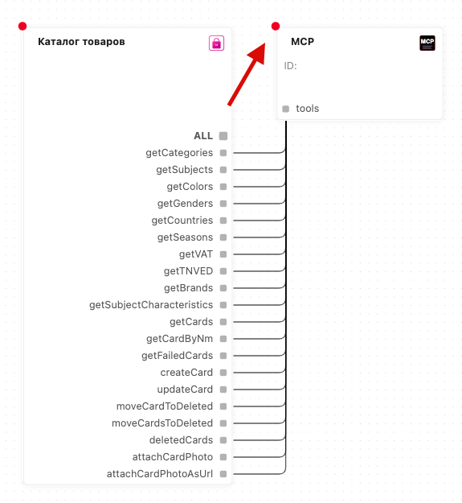

## MCP-адрес

MCP-адрес формируется автоматически на основе значения в поле **ID** на вкладке **Свойства** узла MCP.

Например, если в поле ID указано `wb`, адрес будет выглядеть так: `https://marketaut.ru/mcp/wb`

Для адреса используется значение из поля ID на вкладке **Свойства**, а не уникальный идентификатор узла, который отображается в верхней части панели. Пока поле ID не заполнено, в адресе может отображаться `undefined`.

Готовый адрес можно посмотреть в двух местах:

- в описании узла MCP на панели его свойств;

    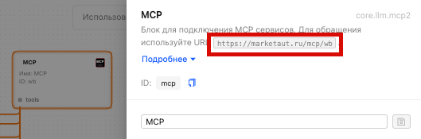

- на домашней странице MarketAut в блоке **Подключите вашего агента** — там его можно скопировать кнопкой **Копировать**.

    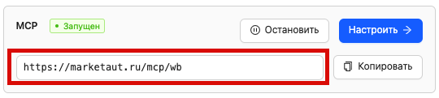

Если изменить значение ID, MCP-адрес тоже изменится. После этого новый адрес нужно указать в подключённом ИИ-сервисе.

## Привязка узла к аккаунту

⚠️ ВАЖНО: аккаунт нужно создать до привязки узла. Подробнее — в разделе [Аккаунты](01-accounts.md).

Многие узлы требуют привязки к аккаунту. Например, узлы для работы с карточками товаров Wildberries нужно привязать к аккаунту, чтобы они работали с нужным магазином.

Для каждого магазина Wildberries можно создать отдельный аккаунт и привязать к нему нужные узлы. Это позволяет работать с несколькими магазинами одновременно — например, настроить копирование карточек товаров из одного магазина в другой.

1. Нажмите на нужный узел на диаграмме — справа откроется панель свойств;
2. Перейдите на вкладку **Аккаунты**;
3. В выпадающем списке выберите нужный аккаунт.

    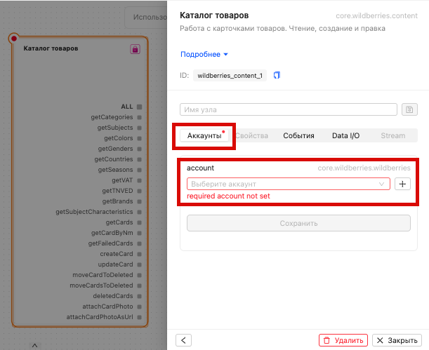

## Соединение узлов

Соединение узлов определяет логику работы диаграммы.

Например, узел MCP предоставляет ИИ доступ ко всем инструментам, подключённым к его входу `tools`. Благодаря этому можно создавать ИИ-агентов с нужным набором инструментов и давать доступ только к тем из них, которые нужны для конкретной задачи.

Соединять можно только выходы со входами. Выходы (1) расположены на правой стороне узла, а входы (2) — на левой.

Чтобы создать связь, нажмите на выход одного узла и, удерживая кнопку мыши, перетащите соединение на вход другого узла.

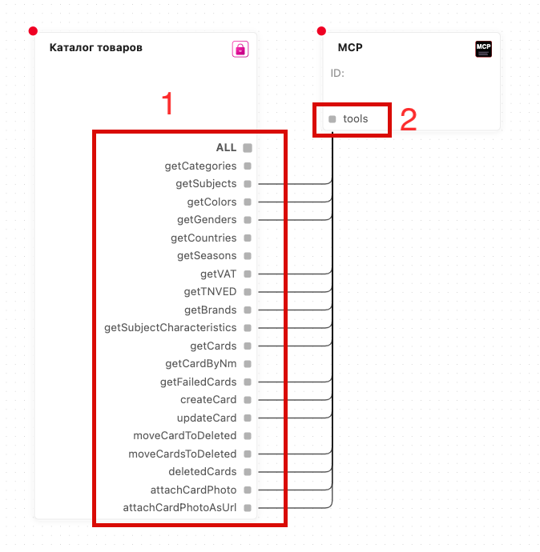

## Подключение всех инструментов через ALL

Узел может содержать несколько инструментов. Чтобы дать ИИ-агенту доступ ко всем инструментам узла, используйте выход `ALL` — так не нужно подключать каждый выход по отдельности.

1. Нажмите на выход рядом с `ALL`;
2. Удерживая кнопку мыши, протяните связь ко входу `tools` узла MCP;
3. Отпустите кнопку мыши.

После этого все доступные инструменты узла будут подключены к MCP. Если ИИ-агенту нужны только отдельные инструменты, соедините с `tools` нужные выходы по одному.

(1) Выход `ALL`;
(2) Вход `tools` узла MCP.

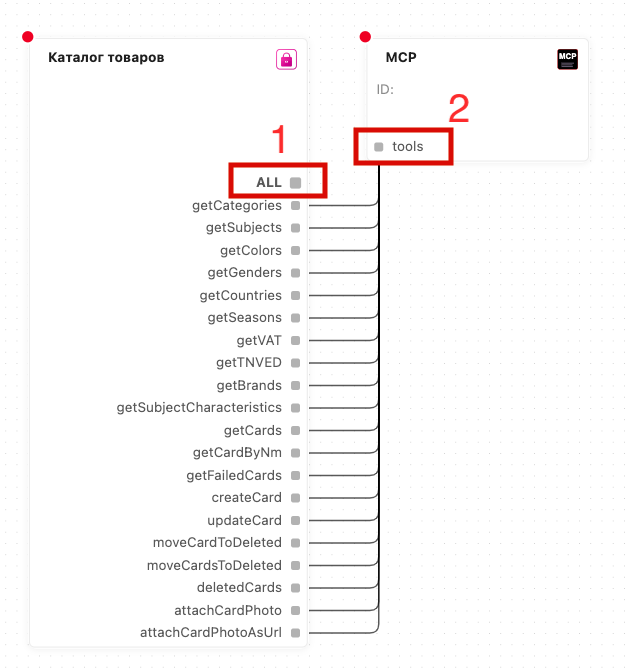

## Разъединение узлов

1. Щёлкните по связи, которую нужно удалить;
2. Нажмите на появившийся значок крестика.

Связь будет удалена.

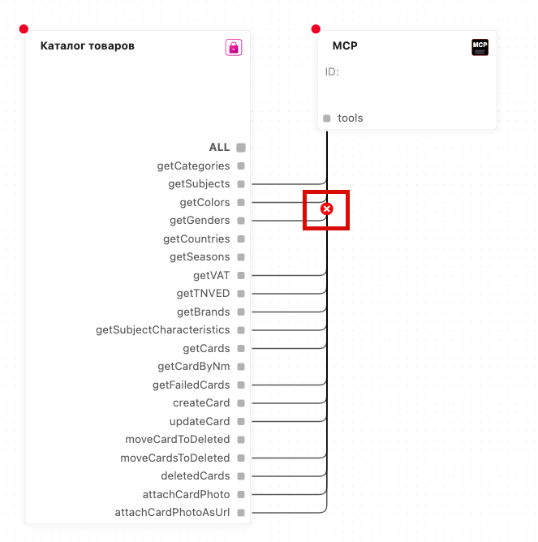

## Удаление узла

⚠️ ВАЖНО: после удаления узла связанные с ним соединения тоже будут удалены, а его функции станут недоступны. Перед удалением убедитесь, что узел больше не используется в диаграмме.

1. Нажмите на нужный узел на диаграмме — справа откроется панель свойств;
2. Нажмите **Удалить**.

    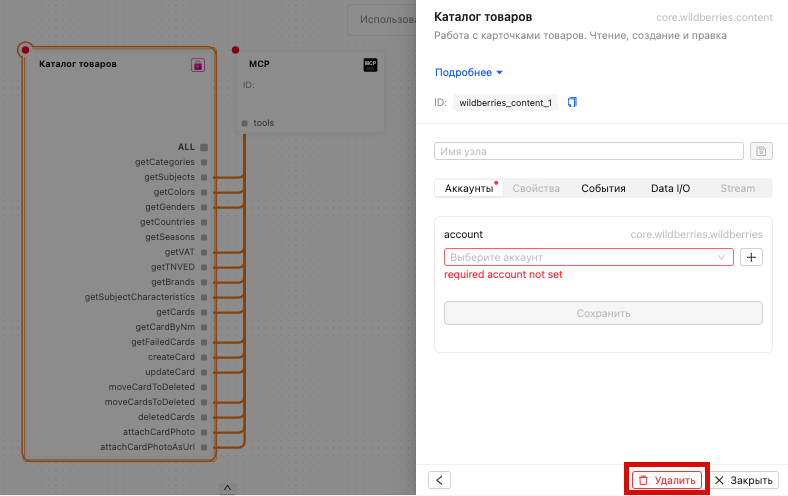