# Общая информация

В этом разделе описан процесс подключения **Claude** к платформе MarketAut по протоколу [MCP](https://modelcontextprotocol.io).

После подключения Claude сможет использовать инструменты и данные, доступные в вашей диаграмме MarketAut, напрямую из диалога.

Перед началом подключения убедитесь, что:

- аккаунт Wildberries успешно создан и настроен — [Настройка аккаунта](/4-platform/01-accounts/); 
- диаграмма создана, настроена и запущена — [Создание и запуск диаграммы](/4-platform/03-diagrams/); 
- получен MCP-адрес на домашней странице MarketAut — [Где найти MCP-адрес](/3-start/02-home/).

> **Важно**
>
> Добавление собственного MCP-коннектора доступно в [веб-версии Claude](https://claude.ai/) и в приложении [Claude Desktop](https://claude.ai/download). В этой инструкции подключение показано на примере Claude Desktop.

## Видеоинструкция

[Смотреть на YouTube →](https://youtu.be/WlDrAIhThdY)

[Смотреть на RuTube →](https://rutube.ru/video/4e85f35c7804ee08a655cc56aa6e4c94/)
## Установка Claude Desktop

Скачайте Claude Desktop с [официальной страницы Claude](https://claude.ai/download).

Установите приложение, запустите его и войдите в свой аккаунт.

## Подключение

1. Запустите приложение Claude Desktop;
2. В боковом меню выберите **Customize**;

    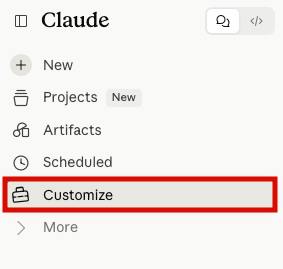

3. Откройте раздел **Connectors**;

    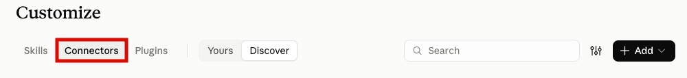

4. Нажмите **+ Add** в правом верхнем углу и выберите **Add custom connector**;

    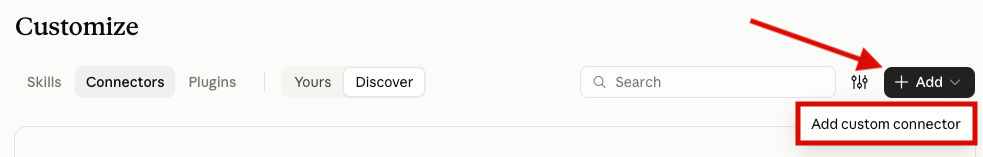

5. В окне добавления коннектора заполните поля и нажмите **Continue**:
    - **Название** — любое удобное название, например `MarketAut WB`;
    - **Адрес** — MCP-адрес с [домашней страницы MarketAut](../3-start/02-home.md), например `https://marketaut.ru/mcp/wb`.
    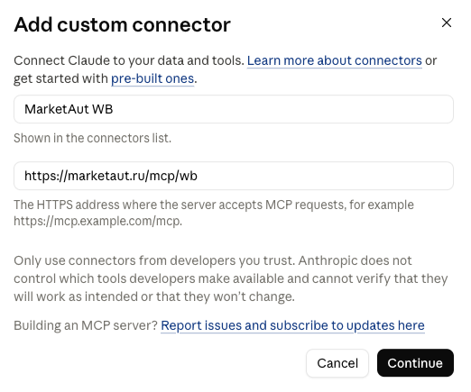
6. В следующем окне проверьте параметры:
    - **Authentication** → **Sign in now**;
    - **OAuth client** → **Use Claude's published identity**.

    Обычно они уже выбраны — тогда ничего менять не нужно.

    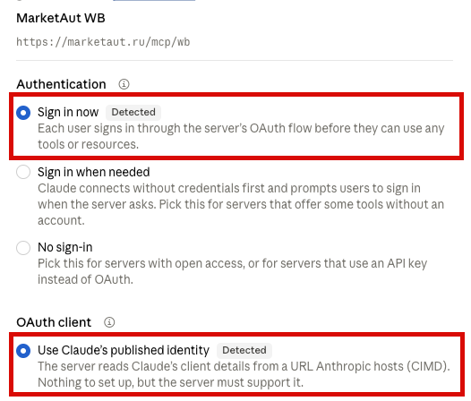

7. Прокрутите окно вниз и нажмите **Add**;

8. В окне предоставления доступа нажмите **Разрешить доступ**.

    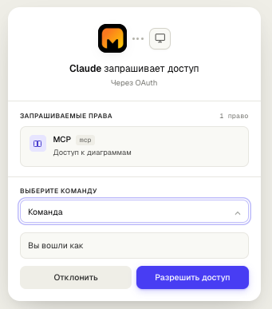

После подключения рядом с коннектором появится отметка подключения, а на его странице — кнопка **Disconnect**.

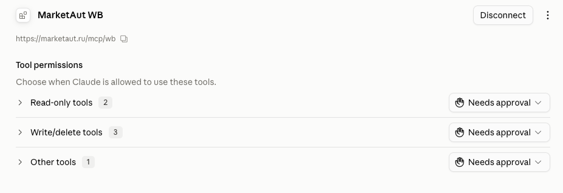
# Работа с Claude

## Проверка подключения

В любом диалоге Claude нажмите кнопку **(+)** рядом с полем ввода сообщения и выберите **Connectors**.

Если подключение настроено корректно, в списке коннекторов будет отображаться **MarketAut WB** (или другое имя, указанное при настройке подключения).
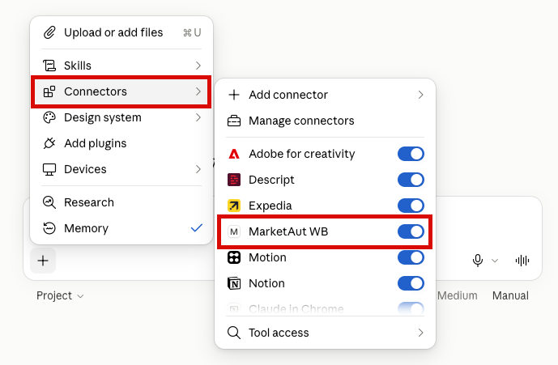
## Пример запроса

Чтобы проверить работу инструментов MarketAut:

1. Откройте новый диалог Claude;
2. Нажмите кнопку **(+)** рядом с полем ввода сообщения;
3. Выберите **Connectors**;
4. Убедитесь, что коннектор **MarketAut WB** включён;
5. Задайте вопрос о вашем магазине, например:

> Выведи список неотвеченных вопросов в моём магазине

Claude обратится к доступным инструментам MarketAut и выведет полученные данные в диалоге.
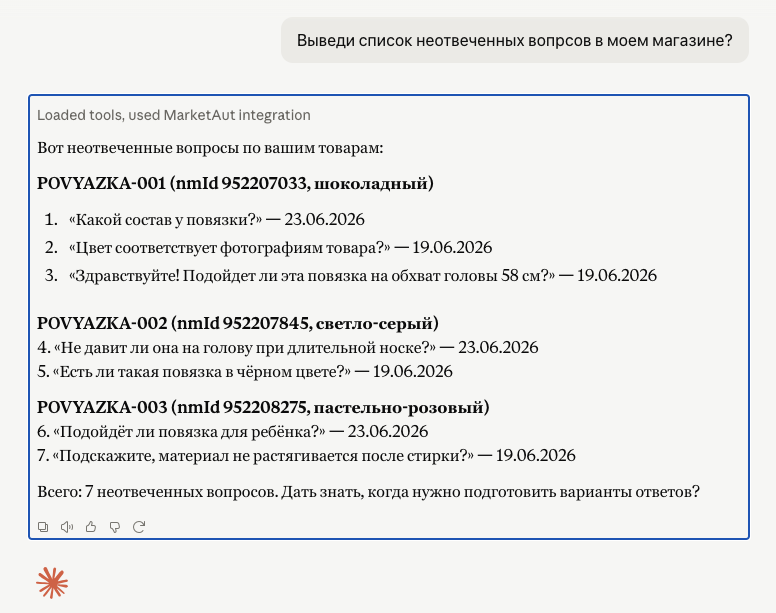

Если Claude получил данные из MarketAut, подключение настроено корректно.
## Обновление инструментов

После изменения списка инструментов в MarketAut необходимо обновить список инструментов в Claude.

1. Перейдите в раздел **Customize**;
2. Откройте раздел **Connectors** и выберите **MarketAut WB**;
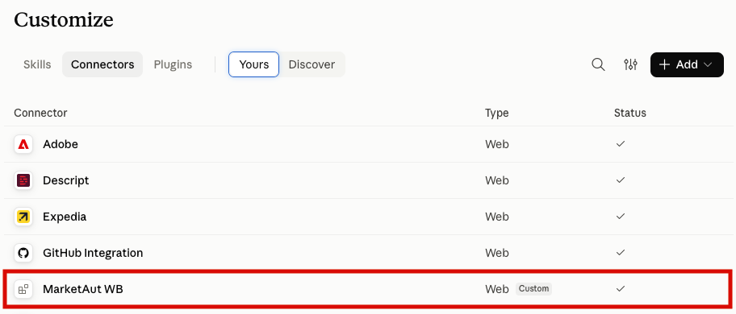
3. Откройте меню **(⋮)** и выберите **Refresh tools list**.
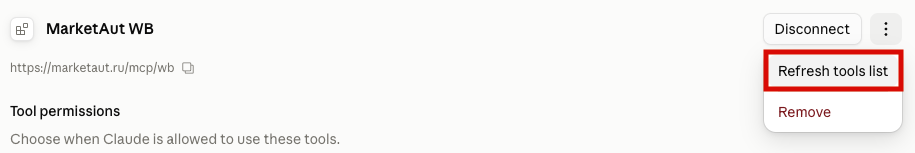

## Настройка доступа к инструментам

Для каждого инструмента можно отдельно настроить способ доступа.

Доступны следующие варианты:

- ✔ **Использование без подтверждения** — Claude использует инструмент без дополнительных запросов;
- ✋ **Подтверждение перед использованием** — перед вызовом инструмента нужно подтверждение;
- 🚫 **Полный запрет** — Claude не может использовать инструмент.

Для настройки перейдите в раздел **Connectors** и откройте коннектор **MarketAut WB**.

В правой части окна отображается список доступных инструментов. Для каждого инструмента можно выбрать один из режимов доступа:

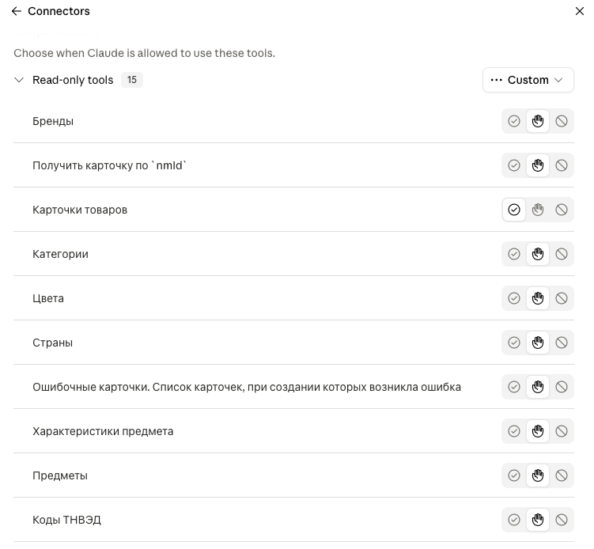

## Удаление коннектора 

1. Перейдите в раздел **Customize**;
2. Откройте раздел **Connectors** и выберите **MarketAut WB**;
3. Нажмите **⋮** справа от кнопки **Disconnect** и выберите **Remove**.

Чтобы временно отключить коннектор без удаления, нажмите **Disconnect**.

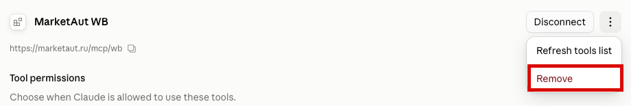