# Общая информация

В этом разделе описан процесс подключения **ChatGPT** к платформе MarketAut по протоколу [MCP](https://modelcontextprotocol.io).

После подключения ChatGPT сможет использовать инструменты и ресурсы, доступные в вашей диаграмме MarketAut, напрямую из диалога.

Перед началом подключения убедитесь, что:

- аккаунт Wildberries успешно создан и настроен — [Настройка аккаунта](/4-platform/01-accounts/); 
- диаграмма создана, настроена и запущена — [Создание и запуск диаграммы](/4-platform/03-diagrams/);
- получен MCP-адрес на домашней странице MarketAut — [Где найти MCP-адрес](/3-start/02-home/).

> **Важно**
>
> Добавление собственного MCP-плагина доступно в [веб-версии ChatGPT](https://chatgpt.com/). После этого плагин станет доступен и в мобильном приложении ChatGPT. Доступность функции зависит от тарифа и прав пользователя в рабочем пространстве. В этой инструкции подключение показано на примере веб-версии ChatGPT.

## Видеоинструкция

[Смотреть на YouTube →](https://youtu.be/FgPWTnW0Kyw)

[Смотреть на RuTube →](https://rutube.ru/video/60b0a79a7f22e59a5912095337064f6d/)

## Подключение

1. В левом меню ChatGPT откройте **Плагины**;

    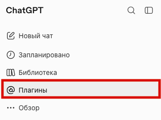

2. Справа нажмите **Добавить** и выберите **Добавить пользовательский сервер MCP**;

    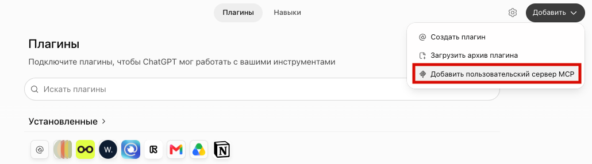

3. Скопируйте MCP-адрес из блока **Подключите вашего агента** на [домашней странице MarketAut](https://marketaut.ru/app/home), например `https://marketaut.ru/mcp/wb`;

    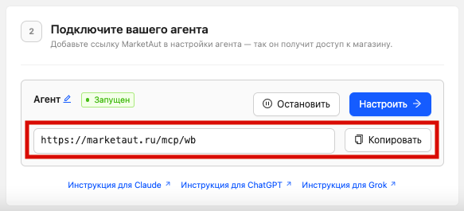

4. Заполните форму:

    - **Название** — любое название на ваш выбор, например `MarketAut WB`;
    - **Описание** — можно оставить пустым;
    - **Подключение** — вставьте скопированный MCP-адрес;
    - **Аутентификация** — `OAuth`.

5. Установите флажок **Я понимаю и хочу продолжить** и нажмите **Создать в виде плагина**;

    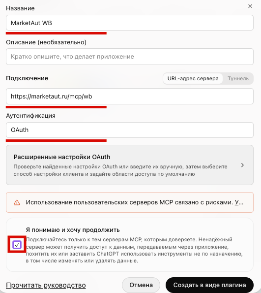

6. Нажмите **Подключить MarketAut WB**;

    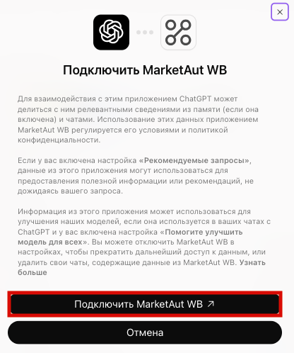

7. В окне авторизации нажмите **Разрешить доступ**.

    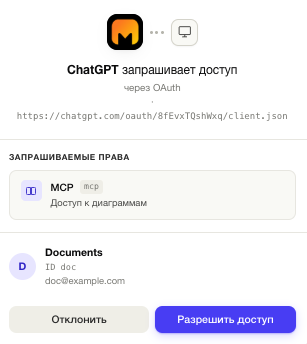

## Проверка подключения

Откройте **Плагины → Личные**. В разделе созданных вами плагинов появится **MarketAut WB**.

Нажмите на **MarketAut WB**, чтобы открыть его страницу.

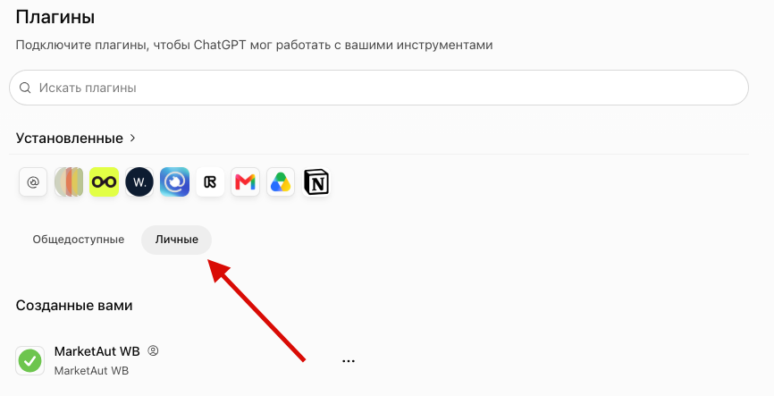

Чтобы посмотреть доступные инструменты, откройте приложение **MarketAut WB** в блоке **Приложения** на этой странице. 

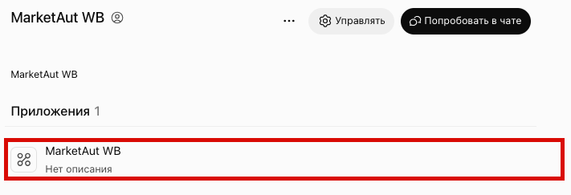

Доступные инструменты будут показаны по группам.

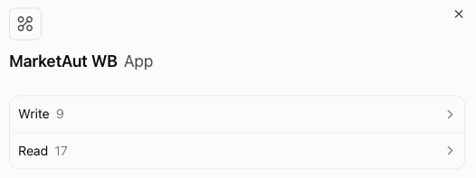

## Проверка в чате

Нажмите **Попробовать в чате** на странице MarketAut WB. Также можно открыть новый чат, нажать **+** возле поля ввода и выбрать **MarketAut WB**.

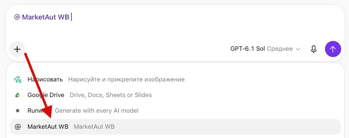

Отправьте запрос, например:

> Проанализируй цены конкурентов на повязки для волос и предложи, какую цену выставить мне.

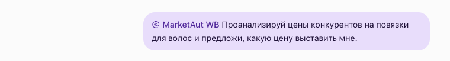

Если подключение работает, ChatGPT обратится к инструментам MarketAut WB и подготовит ответ.

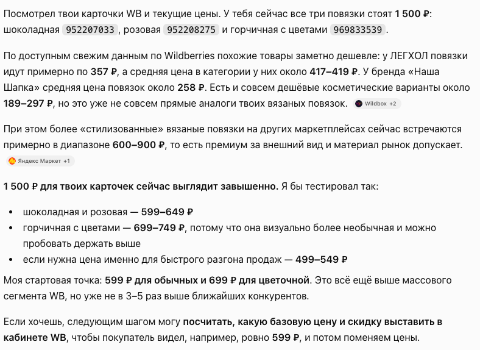

## Обновление инструментов

Если вы добавили новые узлы на диаграмму MarketAut, сначала убедитесь, что диаграмма **запущена**. Остановленная диаграмма не работает, и её инструменты будут недоступны в ChatGPT.

Откройте **Плагины → Личные → MarketAut WB**. Справа выберите **Управлять**.

  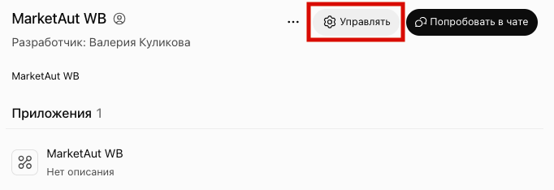

Прокрутите страницу вниз и нажмите **Обновить инструменты**. После обновления проверьте список инструментов приложения MarketAut WB.
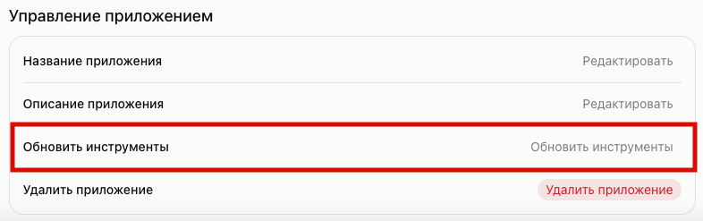
## Удаление плагина

Откройте страницу **MarketAut WB**, справа нажмите  три точки и выберите **Удалить плагин**.

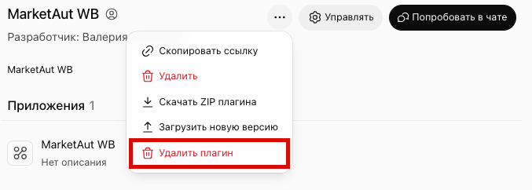