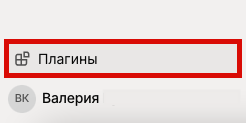
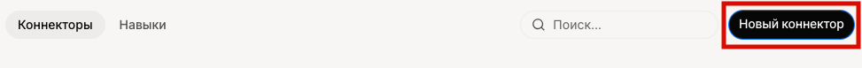
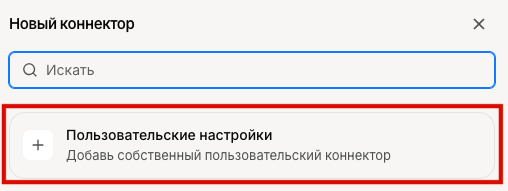
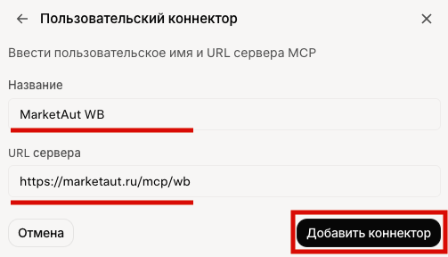
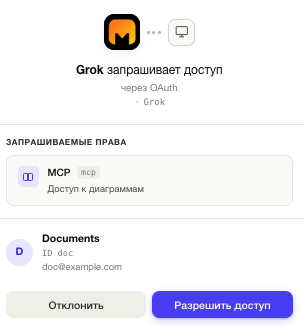
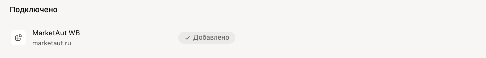
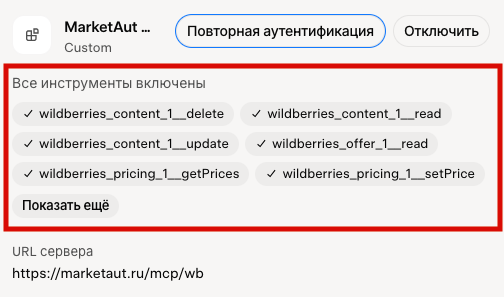
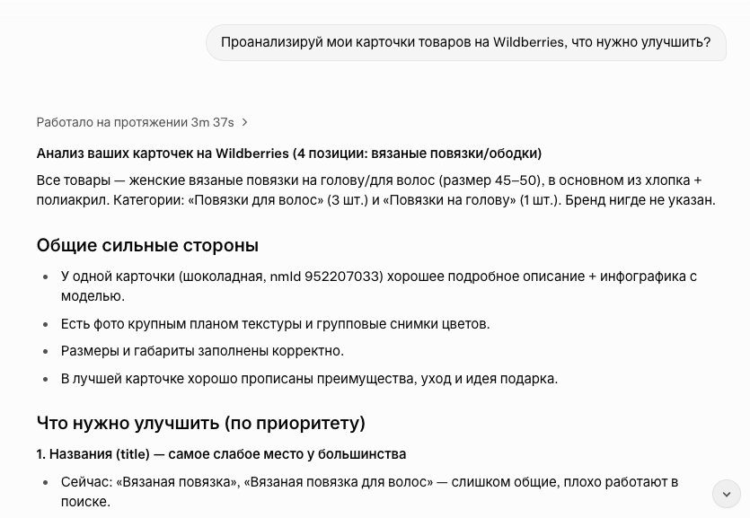
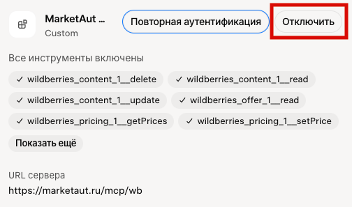

# Общая информация

В этом разделе описан процесс подключения **Grok** к платформе MarketAut по протоколу [MCP](https://modelcontextprotocol.io).

После подключения Grok сможет использовать инструменты и ресурсы, доступные в вашей диаграмме MarketAut, напрямую из диалога.

Перед началом подключения убедитесь, что:

- аккаунт Wildberries успешно создан и настроен — [Настройка аккаунта](/4-platform/01-accounts/); 
- диаграмма создана, настроена и запущена — [Создание и запуск диаграммы](/4-platform/03-diagrams/); 
- получен MCP-адрес на домашней странице MarketAut — [Где найти MCP-адрес](/3-start/02-home/).

> **Важно**
>
> Добавление собственного MCP-коннектора доступно в [веб-версии Grok](https://grok.com/) и в приложении Grok для компьютера. В этой инструкции подключение показано на примере веб-версии Grok.

## Видеоинструкция

[Смотреть на YouTube →](https://youtu.be/f1yZfK4_wbY)

[Смотреть на RuTube →](https://rutube.ru/video/13c685ed8cd4a3568f1f26f5e44a547c/)

## Подключение {#connect}

1. Внизу бокового меню Grok откройте **Плагины**;

    

2. На вкладке **Коннекторы** нажмите **Новый коннектор**;

    

3. В открывшемся окне выберите **Пользовательские настройки**;

    

4. Заполните поля и нажмите **Добавить коннектор**:
    - **Название** — любое удобное название, например `MarketAut WB`;
    - **URL сервера** — MCP-адрес с [домашней страницы MarketAut](../3-start/02-home.md), например `https://marketaut.ru/mcp/wb`.

    

5. В окне предоставления доступа при необходимости выберите команду и нажмите **Разрешить доступ**.

    

После подключения **MarketAut WB** появится в разделе **Подключено** с отметкой **Добавлено**.

## Доступные инструменты

Чтобы посмотреть инструменты MarketAut, доступные Grok, откройте **Плагины → Коннекторы** и нажмите на **MarketAut WB**.

На странице коннектора отображается список инструментов. Чтобы увидеть весь список, нажмите **Показать ещё**.

## Использование Grok

Откройте новый диалог Grok и отправьте запрос, для выполнения которого необходимы данные вашего магазина Wildberries.

Например:

> Проанализируй мои карточки товаров на Wildberries, что нужно улучшить?

Если подключение настроено корректно, Grok сможет обратиться к инструментам MarketAut и получить данные из вашего магазина Wildberries.

## Обновление инструментов

Если вы добавили или удалили инструменты в диаграмме MarketAut, обновите их список в Grok:

1. Откройте **Плагины → Коннекторы** и нажмите на **MarketAut WB**;
2. Нажмите **Повторная аутентификация** и подтвердите доступ.

После этого в списке инструментов появятся изменения.
## Удаление коннектора

1. Откройте **Плагины → Коннекторы** и нажмите на **MarketAut WB**;
2. Нажмите **Отключить**. Коннектор будет удалён из Grok — чтобы подключить его снова, повторите шаги из раздела [Подключение](#connect)
 
    