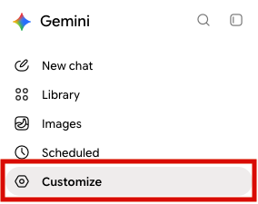
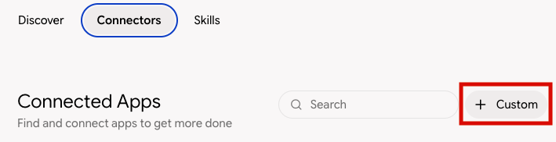
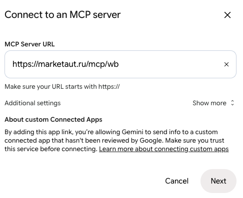
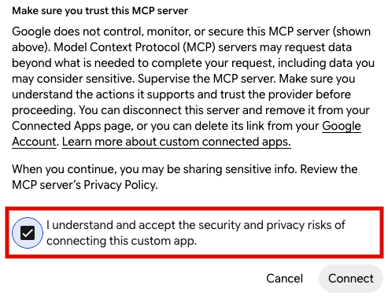
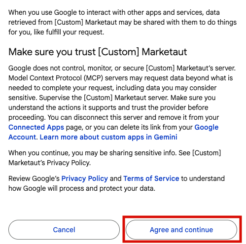
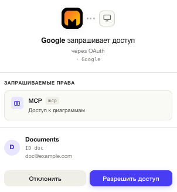
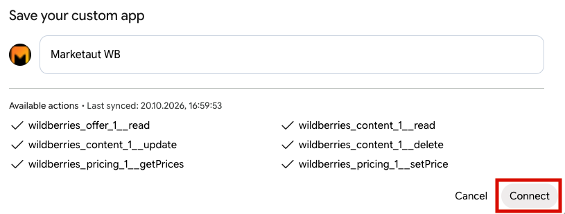
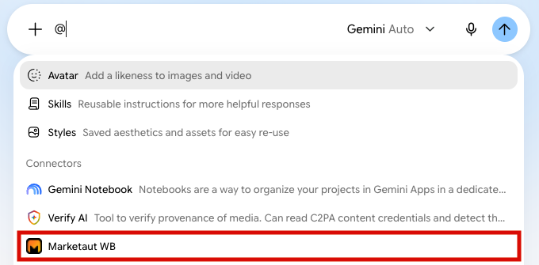
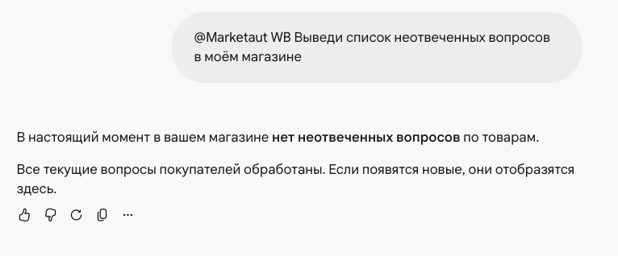
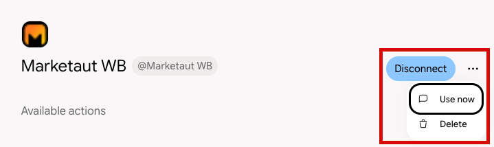

# Общая информация

В этом разделе описан процесс подключения Gemini к платформе MarketAut по протоколу MCP.

После подключения Gemini сможет использовать инструменты и данные, доступные в вашей диаграмме MarketAut, напрямую из диалога.

Перед началом подключения убедитесь, что:

- аккаунт Wildberries создан и настроен — [Настройка аккаунта](../4-platform/01-accounts.md);
- диаграмма создана, настроена и запущена — [Создание и запуск диаграммы](../4-platform/03-diagrams.md);
- получен MCP-адрес на домашней странице MarketAut — [Где найти MCP-адрес](../3-start/02-home.md).

> **Важно**
>
> Добавить собственный коннектор можно только в веб-версии Gemini с **английским** интерфейсом. Откройте страницу коннекторов по ссылке [gemini.google.com/customize/connectors?hl=en](https://gemini.google.com/customize/connectors?hl=en).
>
> Если браузер предлагает перевести страницу на русский, откажитесь: в переводе кнопка добавления не отображается.

## Подключение {#connect}

1. В боковом меню Gemini выберите **Customize**;

    

2. На вкладке **Connectors** нажмите **+ Custom**;

    

3. В поле **MCP Server URL** вставьте MCP-адрес с [домашней страницы MarketAut](https://marketaut.ru/app/home), например `https://marketaut.ru/mcp/wb`, и нажмите **Next**;

    

4. Установите флажок **I understand and accept the security and privacy risks…** и нажмите **Connect**;

    

5. В окне связывания аккаунтов нажмите **Agree and continue**;

    

6. В окне авторизации MarketAut нажмите **Разрешить доступ**;

    

7. Введите любое удобное название, например `MarketAut WB`, и нажмите **Connect**.
    

После подключения MarketAut появится в разделе **Connectors** среди активных.

## Использование Gemini

Откройте новый чат Gemini, введите `@` и в разделе **Connectors** выберите **MarketAut WB**.

Затем отправьте запрос, например:

> Выведи список неотвеченных вопросов в моём магазине

   Если Gemini получил данные из MarketAut — например, показал список вопросов или сообщил, что неотвеченных вопросов нет, — подключение настроено корректно.

## Обновление инструментов

Если в диаграмме MarketAut появились новые инструменты или изменились существующие, переподключите коннектор:

1. Откройте **Customize → Connectors** и нажмите на коннектор **MarketAut WB**;
2. Нажмите **Disconnect**;
3. Снова подключите коннектор по шагам из раздела [Подключение](#connect).

После этого в Gemini появится актуальный список инструментов.
## Отключение и удаление коннектора

1. Откройте **Customize → Connectors** и нажмите на коннектор **MarketAut WB**;
2. Чтобы временно отключить коннектор, нажмите **Disconnect**. Чтобы удалить его полностью, нажмите **⋯** и выберите **Delete**.

    

Чтобы подключить коннектор снова, повторите шаги из раздела [Подключение](#connect).

## Если не подключается

**Ошибка «Account linking is required to use this custom app».** Gemini не получил разрешение от MarketAut. Проверьте, что:

- браузер не блокирует всплывающие окна на gemini.google.com;
- вы вошли в MarketAut в этом же браузере;
- окно авторизации не было закрыто до нажатия **Разрешить доступ**.

Затем обновите страницу и повторите подключение.

**Сообщение «Extensions are unavailable while your Gemini Apps Activity is off».** Коннекторы работают только при включённой истории действий. Нажмите **Manage Gemini Apps Activity** в сообщении и включите сохранение истории.